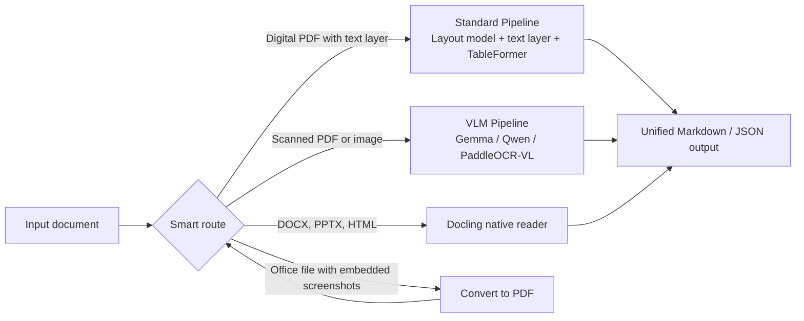

---

## About Me

I build applied AI systems that run where the data lives: offline, on local GPUs, with no cloud dependency. My work sits between **computer vision**, **document AI** and **multimodal LLMs**, and I care most about whether a model holds up on messy, real documents rather than clean benchmarks.

- **MSc in Computer Science and Information Engineering**, National Yunlin University of Science and Technology (YunTech), Taiwan. Top 5% of cohort.
- **Q1 journal publication** in *Engineering Applications of Artificial Intelligence* (Elsevier).
- **Best Presenter Award**, IBCAST 2025.
- **Research Assistant**, Advanced Computing and Analytics Lab.
- I lean on AI coding tools heavily and focus my energy on system design, evaluation and getting results clients can actually use.

---

## Featured Work

### Offline OCR Model Benchmark
[`OCR-model-comparisons`](https://github.com/RM-Abdullah/OCR-model-comparisons)

Benchmarked three open source OCR vision language models to pick the next engine for a security sensitive document extraction service. Everything ran fully offline on a local RTX 5080 (Ubuntu 24.04).

| Model | Speed (pages/sec) | VRAM | Invoice accuracy | Notes |
|---|---|---|---|---|
| **DeepSeek-OCR-2** (vLLM) | **0.413** | ~10.7 GB* | **90.1%** | Fastest, best on bad scans, but drops table delimiters |
| **PaddleOCR-VL 1.6** | 0.166 | ~8.2 GB | 88.9% | Simplest deployment, no confident wrong answers |
| **GLM-OCR** | 0.356 | **~3.3 GB** | 86.4% | Lightest, but misread a cheque amount (3455 vs 3755) |

*vLLM pre-reserves memory, so this is above the true minimum. Speed measured on a 15 page arXiv paper with tables, formulas and multi-column layout; results reproduced across two runs.

What made this useful was going past the headline numbers:
- Removed formatting bias from WER/CER scoring, which showed all three were close on raw accuracy
- Stress tested on degraded 1998 scans, rotated text, diagrams, image-rendered tables and handwritten cheques
- Found failure modes that matter for finance: silent table serialization bugs, repetition loops and confident misreads
- Shipped an offline PaddleOCR-VL service with a unified JSON/Markdown schema and an async FastAPI endpoint

`Python` `vLLM` `PaddleOCR` `FastAPI` `CUDA` `Linux`

### Hybrid Document Parser with Docling
An offline document parsing system that combines **Docling's Standard Pipeline** and **Docling's VLM Pipeline** in one hybrid "smart route". The goal: get the most accurate text, tables and reading order out of any document in the least possible time, without sending a single byte to the cloud.

**The idea:** running a large vision language model on every page is accurate but slow. Running a layout model on every page is fast but fails on scans. So the parser decides, per document and per page, which path is worth the compute.

**What it does**
- **Standard Pipeline** handles born-digital documents: Docling layout models (Heron, Egret) detect structure, text comes straight from the PDF text layer, and TableFormer rebuilds tables. Fast and exact, no OCR needed.
- **VLM Pipeline** handles scanned pages and images, where a vision language model reads the page directly.
- **Native readers** parse Word, PowerPoint and HTML without rasterizing them.
- **Tables to spreadsheets**: extracted tables export cleanly for downstream use.
- **Swappable VLM backends**: any open model plugs in, either locally from Hugging Face (including GGUF) or through an internal OpenAI-compatible llama.cpp server.

**Model comparison**

The same documents run through every backend and are scored on text accuracy, reading order, table structure and time per page, to find which model gives the best result for each document type.

| Backend | Role in testing |
|---|---|
| **Gemma 4** (E4B, 26B-A4B) | Small and mid-size VLM candidates, run locally and on a shared llama.cpp server |
| **Qwen3.5** (9B and larger) | Primary VLM candidate replacing the default Granite-Docling |
| **PaddleOCR-VL 1.6** | Dedicated document OCR model, strongest baseline from the earlier OCR benchmark |
| **Granite-Docling 258M** | Docling's default VLM, used as the reference point |

**Evaluation data:** layout output is checked against human-labeled boxes from **DocLayNet v1.2** (financial reports, scientific papers, manuals), plus real scanned, Office and HTML documents.

**Why hybrid matters:** pages that already have a text layer skip the VLM entirely, so expensive GPU time goes only to the pages that actually need it.

`Docling` `Gemma 4` `Qwen3.5` `PaddleOCR-VL` `llama.cpp` `Hugging Face` `DocLayNet` `GGUF`

### Spatial Multimodal LLM for Melanoma *(research, in progress)*
Training and inference pipeline that fine tunes **Qwen3-8B with LoRA** to reason jointly over spatial transcriptomics, H&E histology and proteomics data from melanoma tissue.

`Qwen3` `LoRA` `PyTorch` `Multi-omics` `Computational Pathology`

---

## Applied AI Demos

| Project | What it does | Stack |
|---|---|---|
| **Scanline** | Real-time object detection in the browser | TensorFlow.js |
| **Inbox Pilot** | AI support ticket triage and prioritization | Claude API |
| **Ochre and Ash** | Conversational AI assistant for a cafe | Claude API |
| **Agri-Smart** | IoT smart agriculture system with VGG19 crop disease detection (BS final year project) | CNN, IoT |

---

## Research

**Q1 Journal Article**, *Engineering Applications of Artificial Intelligence* (Elsevier)
> [Paper title here](https://doi.org/your-doi-here)

**Research interests:** vision transformers and CNNs, ML-based security systems, document AI, multimodal LLMs for biomedical data.

---

## Tech Stack

**Core**

**Models and Inference**

**Deployment and Tools**

---

## Honors

- **Q1 publication**, *Engineering Applications of Artificial Intelligence*
- **Best Presenter Award**, IBCAST 2025
- **Top 5%**, MSc CSIE cohort, YunTech

---

## GitHub Stats

---

## Connect

I'm open to AI Engineer, Computer Vision and Document AI roles in Taiwan, available full time from March 2027.

